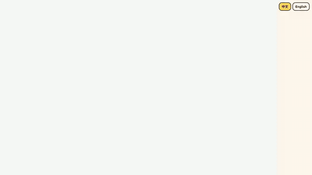
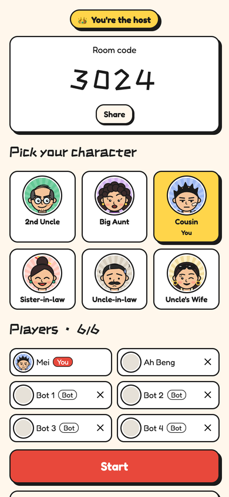
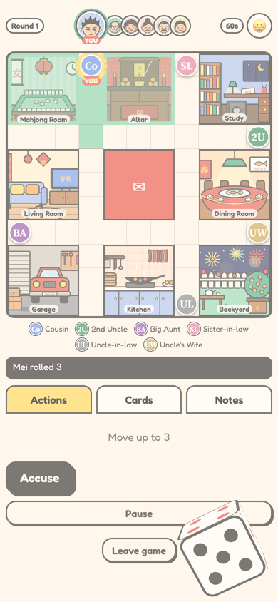
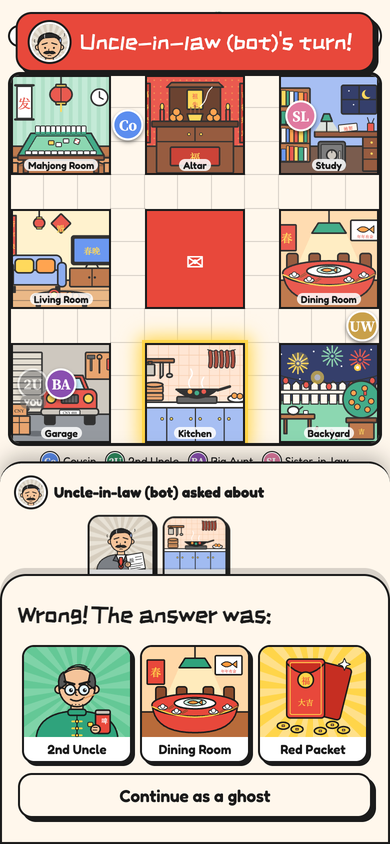
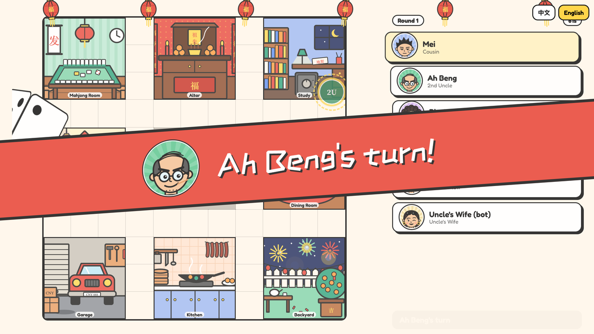
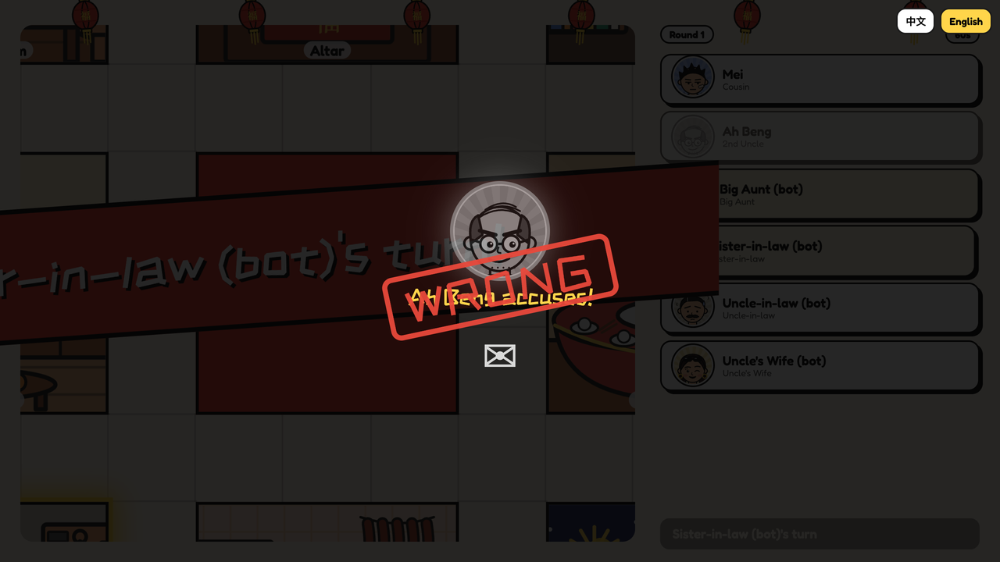

<p align="center"><a href="README.md">English</a> · <b>简体中文</b></p>

<p align="center">
  <a href="https://classic-cluedo-party-game.onrender.com"></a>
</p>

<h1 align="center">谁杀了客人？</h1>
<p align="center"><b>Who Killed the Guest?</b> · 用手机和电视一起玩的新年版 Cluedo</p>
<p align="center"><i>“我知道你们每个人的秘密。”大家的脸色都变了。</i></p>

<p align="center">
  <a href="https://classic-cluedo-party-game.onrender.com"></a>
  &nbsp;
  <a href="https://classic-cluedo-party-game.onrender.com/homepage/"></a>
  &nbsp;
  <a href="docs/DESIGN.md"></a>
</p>
<p align="center"><sub>服务器闲置时会休眠，第一次打开可能要等一分钟左右。</sub></p>

大年初一晚上，全家回到老房子过年。一位没人认识的客人上门拜年，而饭桌上的某个人杀了他。找出凶手、地点和凶器。
3 到 6 位玩家用手机输入 4 位房间号或扫二维码加入，空位由机器人补上。电视可选，用来显示棋盘、轮到谁和精彩时刻，但绝不会显示任何人的手牌。
每张棋盘都是一个主题包：想换一个新的谜案，只需要一个新的美术和数据文件夹，不用改代码。

<table>
  <tr>
    <td width="33%"></td>
    <td width="33%"></td>
    <td width="33%"></td>
  </tr>
  <tr>
    <td colspan="3"></td>
  </tr>
  <tr>
    <td colspan="3"></td>
  </tr>
</table>

<sub>截图为英文界面；游戏内可随时切换中文。</sub>

## 怎么玩

| | |
|---|---|
| **集合** | 房主打开游戏并创建房间，其他人输入 4 位房间号或点分享链接加入。有大屏幕的话，在上面打开 `/tv?code=1234`。 |
| **轮到你** | 掷骰子，在屋子里移动。走进房间就停下。 |
| **推理** | 在房间里说出一个嫌疑人、这个房间和一件凶器。从你开始顺时针，第一个手里有其中一张牌的玩家，会悄悄给你看一张。 |
| **指控** | 每局一次，只能在你的回合。猜对就赢；猜错就变成幽灵，但仍要给别人出示手牌。 |
| **做笔记** | 笔记页会记下你看过的牌。每个回合都有倒计时。 |

---

# 开发者

## 目录

```
classic-cluedo-party-game/
├─ apps/
│  ├─ client/              React + TS + Vite（手机界面和 /tv）
│  └─ server/              Node + Socket.IO（房间、对局、机器人、计时、静态 /themes）
├─ packages/
│  ├─ engine/              纯规则：不做 I/O，不含主题文字，不用 Socket.IO
│  ├─ protocol/            客户端和服务器共用的事件名和 zod 校验
│  └─ theme-sdk/           主题包类型、校验、棋盘图编译器、命令行工具
├─ themes/
│  ├─ cny-guest/           第一个主题包（谁杀了客人？）；其中的 homepage/ 就是 /homepage 主页
│  └─ _fixtures/tiny-manor 7×7 测试棋盘，用来证明代码与主题无关
├─ e2e/smoke.mjs           在真实 Chrome 里玩完一整局（也用来生成 README 截图）
├─ docs/
│  ├─ DESIGN.md            目标、规则、架构、协议、主题包、引擎、开发阶段（英文）
│  └─ architecture/        C4 model.json + architecture.html
├─ media/                  README 用的动图和截图
├─ tools/                  美术导出、开发辅助脚本
├─ prototype/              设计交付稿（只读参考）
├─ CLAUDE.md               改代码的规则（从这里开始读）
├─ LICENSE                 MIT 许可，适用于代码
└─ NOTICE                  美术、故事和媒体：保留所有权利
```

## 运行、测试、部署

需要 Node 22+ 和 pnpm 9。

```bash
pnpm install
pnpm dev                      # 游戏服务器 :3001 + 客户端 :5173（局域网可访问）
pnpm test                     # 所有包：theme-sdk、engine、server（真实 socket）、client（jsdom）
pnpm typecheck
pnpm theme:check cny-guest    # 校验主题包，和服务器启动时的校验完全一样
pnpm e2e                      # 构建客户端，并在真实 Chrome 里玩一局
E2E_SHOTS=/tmp/shots pnpm e2e # 同上，并保存截图和电视画面录像
```

- **手机：** `http://<你的 IP>:5173`。**电视：** `http://<你的 IP>:5173/tv?code=1234`，或扫电视上的二维码。
- **正式运行：** 先 `pnpm --filter @cluedo/client build`，再 `pnpm --filter @cluedo/server start`，所有内容都在同一个端口（`PORT`，默认 3001）。
- **部署：** [`render.yaml`](render.yaml) 会在 [CI](.github/workflows/ci.yml) 通过后把 `master` 部署到 Render 免费方案。房间只存在内存里，所以每次部署都会结束正在进行的对局：在分支上开发，没人玩的时候再合并。用 `E2E_URL=https://… node e2e/smoke.mjs` 检查部署结果。完整步骤见 [docs/DESIGN.md](docs/DESIGN.md#deploy-on-render-free-no-card)（英文）。

代码采用 MIT 许可；美术、故事和媒体保留所有权利。详见 [LICENSE](LICENSE) 和 [NOTICE](NOTICE)。

整体结构：[docs/DESIGN.md](docs/DESIGN.md)（英文）和 C4 架构图 [docs/architecture/architecture.html](docs/architecture/architecture.html)。
